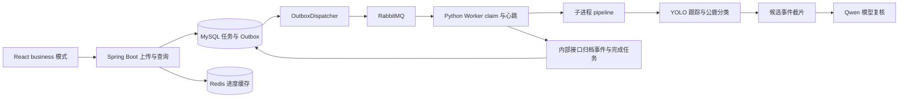

# 梅花鹿行为检测项目：开源项目借鉴分析

研究日期：2026-10-16（Asia/Shanghai）。本地代码基线：`27a370d`；开始审查时工作区干净。

本次只研究与编写文档，没有修改业务代码、安装依赖、启动基础服务或运行模型。下文的验证方法是未来改造的验收方案，不代表本次执行结果。`BUSINESS_VERIFICATION.md` 中 2026-09-18 的通过记录属于历史证据，不能替代当前环境复测。

外部研究方式：先阅读本地真实代码，再在线阅读七个仓库的相关源码。链接指向本次读取的 `master/main/develop` 分支，分支会移动；网页抓取存在缓存，不能据此断言最新发布版本或部署兼容性。正式实施时应记录实际安装版本及对应 commit/tag，再核对接口。未取得可靠的外部 commit SHA，因此不伪造固定版本证据。本文没有对七个仓库做全量审计。

## 一、当前项目的真实基础

### 1. 两条运行链路需要分开判断

另一条旧链路是 `src/deer_behavior/app.py::create_app` 中的 FastAPI、进程内 `queue.Queue` 和守护线程，配合任务文件及旧 repository/SQLite。业务版已经使用独立 Worker 和 MySQL，不能把旧链路的内存队列问题误判为新链路的问题，也不应为借鉴 FastAPI 模板而替换现有 Spring Boot。

### 2. 本地证据与缺口

以下路径均相对于仓库根目录；列出函数便于检索。后续建议以这些实现为起点。

| 编号 | 本地文件 / 函数 | 真实现状 | 判断与边界 |
|---|---|---|---|
| L1 | `backend/.../service/TaskService.java::upload`；`mq/OutboxDispatcher.java::dispatch` | 数据库事务同时保存任务与 Outbox；调度器每 2 秒取最多 20 条待发记录 | 已解决数据库提交后未投递的常见窗口。多实例无 Outbox 抢占；逐条同步确认最坏会拉长批次，不能保证所有任务都在 2 秒内投递 |
| L2 | `mq/TaskPublisher.java::send`；`config/RabbitConfig.java`；`application.yml` | persistent 消息；correlated confirm；mandatory/returns；主队列、failure、TTL retry、DLQ；Java 手动 ACK | 已有可靠性基础，不能再推荐“先加 RabbitMQ 和 ACK”。classic 队列及 broker 内部死信转发仍有故障边界 |
| L3 | `worker/consumer.py::process` | `prefetch_count=1`，`auto_ack=False`；归档、完成成功才 ACK；父进程维持 broker 心跳，子进程执行推理 | 进程死亡可检测；存活但卡死的子进程没有业务截止时间，父进程仍可一直续租 |
| L4 | `service/TaskStateService.java`；`repository/TaskRepository.java` | 行锁、条件状态更新、leaseToken 隔离、120 秒默认租约；最多 4 次 claim；终态不回退 | 已是至少一次执行下的业务幂等设计，不是跨系统 exactly-once |
| L5 | `TaskService.java::archive`；`entity/BehaviorEvent.java` | 按 `(taskId,eventIndex)` 查重并设联合唯一约束；Worker 分别调用 events 与 COMPLETED | 防止重复行，但归档已提交、完成未提交后重跑，新摘要可能与旧 attempt 的事件不一致。属于代码推导出的故障窗口，尚未注入复现 |
| L6 | `service/ProgressService.java::write/read` | Redis Hash，终态 24 小时 TTL；Redis 异常降级；查询用数据库纠正终态 | 无须通用 Redis 大封装；写 Redis 在任务事务与行锁期间，故障超时可能延长锁持有时间 |
| L7 | `pipeline.py::_run_video_core`；`detection.py::MaleIdentifier` | `track(stream=True,persist=True)`；分类每隔 `classify_stride` 帧批量处理 crop；概率窗口锁定公鹿 | 已有流式推理、跳帧分类和批处理，不能把这些当成尚未实现的优化 |
| L8 | `detection.py::parse_yolo_detections` | `boxes.id` 缺失时使用 `np.arange(len(xyxy))` | 帧内序号不等于跨帧身份，可能污染公鹿窗口和事件持续时间 |
| L9 | `detection.py::_classify_frame` | OpenCV crop 先 BGR→RGB，再把 ndarray 列表传给 Ultralytics classifier | 与本次读取的上游 ndarray 输入契约不符，存在重复换通道风险；需按实际安装版本验证，不能直接宣称分类准确率已受损 |
| L10 | `event_buffer.py::add_frame/trigger/close`；`pipeline.py` 事件归档段 | 缓存完整分辨率标注帧；同时打开多个事件 writer；保存时间用触发时间 ± 配置秒数 | 视频首尾截断时实际片段与声明时间可能不同；保存顺序是关闭顺序，变更截片策略时应注意 eventIndex 稳定性 |
| L11 | `interaction.py::InteractionTrigger.update` | 两两 IoU 为 O(n²)；按鹿对、reason 记录持续与冷却；未出现的 active key 会清理 | 相同鹿对可同时触发 male_overlap 与 any_pair_iou；cooldown 与分类 tracks 状态缺少过期清理。是否构成瓶颈须测量 |
| L12 | `pipeline.py::draw_frame`；`video_utils.py::make_browser_mp4` | 显示的是源视频 FPS；FFmpeg 同步转码，无 timeout，失败再尝试 WebM | 不能把画面 FPS 当吞吐；长转码或挂起可能拖住整个任务 |
| L13 | `frontend/src/App.tsx`；`hooks.ts`；`components.tsx` | 多页面集中 App；已有请求中止、串行定时轮询、终态停止、独立 Player 与 Chart | 应增量拆页面，保留已有轮询和播放器行为，不必迁移 Umi 或全换组件库 |
| L14 | `frontend/src/businessApi.ts::list/jobs/history`；`App.tsx::Tasks` | 拉最近 1000 条，任务历史在浏览器筛选分页；jobs 对每个非终态请求 progress | 存在截断后的筛选偏差与 N+1 轮询。后端 `/api/tasks` 已支持分页、状态与日期，前端尚未充分使用；后端当前 taskId 为精确查询，不支持文件名模糊搜索 |
| L15 | `QueryController.java`；`WorkerDtos.java`；`AnalysisTask.java` | 内部 DTO 有验证；查询 controller 直接调用 repository，并从 entity 转 Map；lease 字段已有 JsonIgnore | 可改显式响应 DTO 与查询 service；不能误称 leaseToken 已公开。videoPath/resultVideoPath 等内部路径仍随实体映射，需要收敛响应契约 |
| L16 | `BehaviorEvent.java`；`App.tsx::EventDetail`；`qwen_vl.py` | 有规则、模型结论和依据；详情页只能读，没有人工审核字段与写接口；解析把“疑似异常”归为“异常” | Qwen 复核不是人工审核；REVIEWING 表示模型阶段。人工真值、疑似语义与审计需要另建 |
| L17 | `docker-compose.yml`；`deploy/rabbitmq-business.conf` | Compose 仅 MySQL/Redis/RabbitMQ；只有 MySQL 配 healthcheck；原生 Rabbit 配了 12 小时 consumer_timeout | 没有应用 Dockerfile，Compose 没挂载该 Rabbit 配置；原生与容器长任务 ACK 配置可能不同 |
| L18 | `StateTests.java`；`scripts/verify_business.py`；前端两个 spec | 状态/租约/去重测试；隔离真实中间件集成脚本；前端路由 mock 契约测试 | 不是没有测试。未见 `.github/workflows`，未见独立 Python 算法测试；H2 不替代 MySQL 并发语义，mock 页面测试不等于真实 AI 端到端 |

## 二、macrozheng/mall：分层与基础设施封装

### 1. 值得阅读的具体源码

| 源码链接 | 阅读重点 |
|---|---|
| [PmsProductController.java](https://github.com/macrozheng/mall/blob/master/mall-admin/src/main/java/com/macro/mall/controller/PmsProductController.java) | 请求参数进入 service，分页结果形成明确的 API 返回边界 |
| [RedisServiceImpl.java](https://github.com/macrozheng/mall/blob/master/mall-common/src/main/java/com/macro/mall/common/service/impl/RedisServiceImpl.java) | Redis 的值、Hash、过期时间操作集中管理 |
| [RabbitMqConfig.java](https://github.com/macrozheng/mall/blob/master/mall-portal/src/main/java/com/macro/mall/portal/config/RabbitMqConfig.java) | 延迟队列、死信交换机和路由配置集中定义 |
| [CancelOrderSender.java](https://github.com/macrozheng/mall/blob/master/mall-portal/src/main/java/com/macro/mall/portal/component/CancelOrderSender.java) / [CancelOrderReceiver.java](https://github.com/macrozheng/mall/blob/master/mall-portal/src/main/java/com/macro/mall/portal/component/CancelOrderReceiver.java) | 发送端只传 orderId、设置消息过期；消费端调用业务 service |

### 2. 工程问题与核心实现

controller 不承担商品业务，消息组件不直接混入订单逻辑；Redis 操作和消息拓扑有集中边界。TTL 消息到期通过死信路由进入业务消费队列，消费者使用业务标识重新执行业务判断。这些文件适合学习职责划分，但该取消订单示例本身没有展示本项目已有的事务 Outbox、发布确认与租约保障，不能把它当成更完整的可靠投递方案。

### 3. 当前项目对应问题

L1—L6 已经有更贴合视频任务的投递与状态机制。真正适合借鉴的是 L15：查询、统计和 Map 组装集中在 `QueryController`；实体字段变更容易无意影响公开响应。Redis 已集中在 `ProgressService`，没有必要照搬通用 Redis 接口及大量无用方法。

### 4. 最小改动建议

- 先引入 `TaskResponse`、`EventResponse`、分页响应 record，仅列出页面需要的字段；保持现有字段名和 HTTP 202/4xx 语义，逐步去掉内部绝对路径。不要为了统一包装破坏 `businessApi.ts`。
- 将现有查询 Specification、统计和 DTO 映射移入一个查询 service，保持 JPA 与现有事务入口；不强制每个 service 再拆 interface/impl，不引入 MyBatis、多模块或微服务。
- 保留 `TaskPublisher`、`RabbitConfig` 和 `ProgressService` 的业务边界；只在确有多处需求时抽取键前缀、TTL 和队列常量。Redis 失败降级应继续保留。
- Redis 写移出行锁持有阶段需作为独立后续优化：提交后回调会引入缓存乱序，必须用数据库状态兜底，并按需要加入单调版本校验，不能简单移动一行代码。

### 5. 如何验证

对比改造前后上传、分页、事件详情的字段契约；验证令牌和内部路径不进入公开 DTO。重跑既有状态测试、两套前端契约测试和隔离集成脚本。停止测试 Redis，确认上传/详情仍可用，测量 claim、heartbeat 的 p95 延迟和锁等待，而不是只检查接口返回 200。

## 三、roboflow/supervision：视频流水线与检测数据边界

### 1. 值得阅读的具体源码

| 源码链接 | 阅读重点 |
|---|---|
| [supervision/utils/video.py](https://github.com/roboflow/supervision/blob/main/supervision/utils/video.py) | `VideoInfo`、`VideoSink`、帧生成器、`process_video` 的有界读写队列、`FPSMonitor` |
| [supervision/detection/core.py](https://github.com/roboflow/supervision/blob/main/supervision/detection/core.py) | `Detections` 与 `from_ultralytics`：标准化坐标、置信度、类别与可缺失的 tracker_id |
| [supervision/tracker/byte_tracker/core.py](https://github.com/roboflow/supervision/blob/main/supervision/tracker/byte_tracker/core.py) | `update_with_detections`、未匹配目标过滤、lost track buffer、`reset` |

### 2. 工程问题与核心实现

检测数据结构统一可减少模型与业务规则耦合；ByteTrack 保留轨迹生命周期并过滤未匹配目标。视频模块把读取、主线程处理和写入串成有界队列，限制缓存并让 I/O 与处理重叠；计时器用于观察真实吞吐。这些是组织视频处理的机制，不保证每种工作负载都会提速。

### 3. 当前项目对应问题

对应 L8、L10—L12。现有环形前帧缓存本来就是有界的，不应误称无限缓存，但内存仍可很大：1080p BGR 单帧约 5.93 MiB，默认前 5 秒、25 FPS 的 125 帧约 742 MiB，仅为环形缓存估算，尚不含模型、复制和其他缓冲。两两 IoU 是否值得向量化取决于鹿数量和耗时占比。

### 4. 最小改动建议

- 保持本项目 `Detection` 数据类，区分“检测到目标”和“已建立跟踪身份”；缺失 ID 时可继续画框，但不进入依赖身份的持续触发与公鹿概率历史。无需为此引入 supervision 依赖。
- 先记录模型加载、推理、分类、画图/写入、截片、转码、Qwen 的耗时，单列源 FPS 和处理 FPS。记录最大 active writer 数与 RSS。
- 已由 Ultralytics 解码时不要再叠加一套读线程。若测出编码瓶颈，先只给完整视频 writer 增加小容量队列，明确阻塞背压、错误传播、取消和退出协议；保持跟踪与规则更新按帧顺序运行。
- 事件记录保存实际首尾帧号、触发帧号和实际写入帧数。文件结束时据实际写入范围归档，统一零起点帧号及时间语义；不要仅用 `trigger_time ± seconds` 推算。
- 长视频再考虑过期清理 tracks/cooldown。事件合并仅合并同鹿对且时间重叠的窗口，同时保留所有触发原因；不要把不同鹿对的事件合并。

### 5. 如何验证

用固定视频分别测低鹿密度、多鹿交叠、视频首尾触发和长视频；固定权重、参数、GPU、分辨率、输出编码，分别记录冷启动和热运行，至少重复 3 次报告中位数。比较吞吐、峰值 RSS、片段帧数、事件召回及重复事件数。帧时间测试覆盖首帧、最后一帧、短于 pre/post 窗口的视频；恒定帧率时误差控制在 1 帧，变帧率需以 PTS 单独验证。队列优化必须能在 writer 异常时退出，不能因测试只跑正常路径而遗漏死锁。

## 四、ultralytics/ultralytics：跟踪状态、输入契约与性能测量

### 1. 值得阅读的具体源码

| 源码链接 | 阅读重点 |
|---|---|
| [ultralytics/trackers/track.py](https://github.com/ultralytics/ultralytics/blob/main/ultralytics/trackers/track.py) | `on_predict_start`、`on_predict_postprocess_end` 的 tracker 持久化和视频切换重置 |
| [ultralytics/cfg/trackers/botsort.yaml](https://github.com/ultralytics/ultralytics/blob/main/ultralytics/cfg/trackers/botsort.yaml) | 高低分关联、轨迹保留、运动补偿、ReID 开关 |
| [ultralytics/engine/predictor.py](https://github.com/ultralytics/ultralytics/blob/main/ultralytics/engine/predictor.py) | ndarray BGR 输入、设备/精度转换及流式预测组织 |
| [ultralytics/models/yolo/classify/predict.py](https://github.com/ultralytics/ultralytics/blob/main/ultralytics/models/yolo/classify/predict.py) | 分类专用预处理，与通用检测预处理的衔接 |

### 2. 工程问题与核心实现

跟踪通过预测回调维护状态，`persist` 决定复用；BoT-SORT 参数控制关联与丢失保留，ReID 需要额外计算。输入预处理负责通道、归一化和设备转换，分类分支也按 ndarray BGR 契约处理。流式返回减少结果累积，但不能限制业务自己保存的帧缓存。

### 3. 当前项目对应问题

L7 的模型跟踪和批量分类已经存在。L9 的 crop 通道风险值得优先验证。每次 Worker 子进程都新建 detector/classifier，当前没有证据表明不同任务串用了 tracker；只有将来改成常驻模型时，跨视频重置才会成为新增风险。`requirements.txt` 仅写 `ultralytics>=8.2`，与实际部署版本及本次上游代码可能不同。

### 4. 最小改动建议

- 先记录实际 `ultralytics`、torch/CUDA 版本及权重摘要；根据该版本的分类输入契约做 BGR/RGB 对照。若确认上游负责转换，仅去掉本地多余转换，保持训练预处理一致。
- 把当前 BoT-SORT 参数作为基线，逐项比较 track buffer、匹配阈值和运动补偿；固定摄像头也应比较后再关闭 GMC。默认不开 ReID，不因最新仓库出现新 tracker 就更换算法。
- 对 detector、classifier 分别采集耗时与输入尺寸；优先调整分类 stride/批次及图像尺寸，半精度或导出推理引擎排在后面，每次只变一个因素。
- 保留单任务子进程的显存隔离。只有模型加载占比明显时，才评估每 GPU 单常驻推理进程，并显式重置 tracker、公鹿历史、事件状态；这不是第一轮最小改动。

### 5. 如何验证

使用包含已知公鹿/非公鹿的固定 crop，比较文件路径输入与原始 OpenCV BGR ndarray 输入的概率，再对比现有预转换路径。记录概率差和分类混淆矩阵，不能仅以“执行无异常”验收。跟踪用人工标记的交叉、遮挡、离场重入片段统计 ID switch、目标锁定耗时与事件召回；调参后保留原模型基线。没有真实 GPU 测试前，不写提速百分比。

## 五、celery/celery：ACK 语义、异常分类与有界重试

### 1. 值得阅读的具体源码

| 源码链接 | 阅读重点 |
|---|---|
| [celery/worker/request.py](https://github.com/celery/celery/blob/main/celery/worker/request.py) | `on_success/on_failure/on_retry`、worker lost、超时、ACK/reject 分支 |
| [celery/app/autoretry.py](https://github.com/celery/celery/blob/main/celery/app/autoretry.py) | 可重试与不可重试异常、退避上限、jitter、最大重试次数 |

### 2. 工程问题与核心实现

Celery 把成功、正常异常、超时和进程丢失分别处理；late ACK 的实际结果还受失败 ACK 与 worker-lost 策略影响。自动重试按异常类型选择，并支持有上限的指数退避与抖动。启用 late ACK 不等于所有失败都重投，更不等于副作用 exactly-once。

### 3. 当前项目对应问题

L2—L5 已有 pika 的手动 ACK、prefetch=1、租约和次数限制，暂不迁移 Celery。缺口是所有处理异常走相近重试流程；永久文件错误也消耗预算；固定 10 秒重试容易在依赖恢复时集中返回。L3 的卡死与 L5 的跨 attempt 结果一致性比“换任务框架”更急迫。Qwen 异常在 `analyze_video` 内转为“复核失败”，不会自动触发 Worker 整任务重试，应单独设计复核补偿。

### 4. 最小改动建议

1. **先加截止时间。** 子进程总时长与阶段静默时间分开设置；Qwen/转码阶段可能没有逐帧进度，须使用适合该阶段的预算。超过预算时终止并确认子进程退出，再 release/NACK；FFmpeg 也要 timeout。broker heartbeat、数据库 lease 与任务业务 timeout 是三种不同机制。
2. **再分异常。** 网络超时、临时服务不可用可重试；输入不可解码、文件确实缺失、模型配置错误等明确永久错误应记录原因并终止或送 DLQ。判断文件缺失时考虑共享盘暂时不可用，不能一概当永久错误。busy 重投与真实 attempt 分开统计。
3. **分级退避。** 最小实现使用固定 TTL 的 10/30/90 秒队列，按 attempts 路由并保留当前 4 次执行上限；若加 jitter，需单独设计调度，不能假装三个固定队列已有随机抖动。避免在单 FIFO 队列混用任意消息 TTL 而忽略队头延迟。
4. **补结果提交边界。** 优先新增一个内部 finalize 接口，在同一数据库事务中校验当前 lease、写整批事件和 COMPLETED/摘要。旧归档接口若继续用于中间结果，必须增加 attempt/batch 身份、隔离未提交批次，明确整批替换/提交规则；仅增加 finalize 而仍复用旧混合事件不能修复问题。保留完成响应丢失后的幂等返回。
5. **Outbox 先观测再扩容。** 增加最老未发消息年龄、待发数、确认失败计数；多 API 实例前补数据库 claim/抢占与过期恢复。不要在持有数据库行锁时同步等待全部网络 confirm。

### 5. 如何验证

在隔离 vhost/数据库内分别注入：确认成功但 sent 未保存、归档成功但完成请求丢失、完成成功但 ACK 前退出、子进程存活挂起、Worker 父进程被杀、旧 token 延迟写入、MQ 断线。检查最终事件与摘要来自同一已提交批次；终态不回退；重复投递不重复归档；旧 token 被拒绝；实际执行不超过 4 次；超时任务最终结束；确认路由失败不会被当成已投递。详见第九节。

## 六、fastapi/full-stack-fastapi-template：部署与自动化验证

### 1. 值得阅读的具体源码

| 源码链接 | 阅读重点 |
|---|---|
| [compose.yml](https://github.com/fastapi/full-stack-fastapi-template/blob/master/compose.yml) | 数据库与后端健康检查、健康依赖、环境变量和构建入口 |
| [.github/workflows/test-backend.yml](https://github.com/fastapi/full-stack-fastapi-template/blob/master/.github/workflows/test-backend.yml) | PR 测试、数据库准备/迁移、超时、覆盖率和报告产物 |
| [.github/workflows/playwright.yml](https://github.com/fastapi/full-stack-fastapi-template/blob/master/.github/workflows/playwright.yml) | 变更路径过滤、浏览器测试、失败 trace、报告汇总与产物保留 |
| [frontend/src/routes/_layout/items.tsx](https://github.com/fastapi/full-stack-fastapi-template/blob/master/frontend/src/routes/_layout/items.tsx) | 页面、服务调用、列表列定义与业务组件分离 |

### 2. 工程问题与核心实现

Compose 用健康状态组织启动依赖；Actions 将后端与浏览器测试固化成 PR 检查，并保存可检查的结果。前端页面组合业务组件，通过明确服务接口取数据。启动健康检查并不保证运行期间永不失效，应用仍需重连与降级。

### 3. 当前项目对应问题

对应 L13、L17、L18。本项目已有 Java 测试、Playwright 与真实中间件脚本，但没有把它们变成自动门禁。两个 Playwright 配置当前都指定 `channel: msedge`，Linux CI 需要显式选择并安装可用浏览器。现有原生测试脚本假设本机 root mysql/rabbitmqctl，不能原样作为容器 CI 脚本。

### 4. 最小改动建议

- 第一阶段仅补 CI 设计：Java 17 `mvn -f backend/pom.xml verify`；前端 `npm ci`、两种模式构建、两套 Playwright；Python 用轻量 fake 测试规则、帧边界与 Worker 协议，不在普通 PR 安装 torch/Qwen。
- 第二阶段新增容器化集成作业：独立测试库/vhost、测试凭据、等待就绪、显式推理替身、失败保留日志、始终清理测试资源。Redis 也须隔离实例或数据库编号和命名空间；当前原生脚本并未单独隔离 Redis，不能沿用业务进度缓存。
- 为应用分步补 Dockerfile：先 Java jar 和 React 静态产物；GPU Worker 使用独立镜像/可选部署方案，权重挂载，媒体卷路径与内部 API 一致；保留 AutoDL 原生部署方式。
- Compose 增加 Redis/RabbitMQ/应用健康检查，应用容器使用服务名连接，不沿用 `127.0.0.1`；按容器部署绑定地址配置 API。挂载专用于容器的 Rabbit 配置，核对 consumer_timeout 与最长任务预算。
- 从 `ddl-auto=update` 迁移到受控数据库迁移需单独做存量 schema 基线和回滚演练；先确保测试库可从零创建及从上一版升级，再用于生产。
- CD 放在 CI 之后：按 commit 生成不可变镜像标识，测试环境部署、健康及小视频 smoke 验证后晋级；保存前一版本镜像，回滚应用前确认数据库迁移兼容。本文只给设计，不执行发布。

### 5. 如何验证

全新 runner 无模型权重也应完成 CPU 契约测试。故意破坏状态转换或前端类型，检查 CI 能阻断并提供报告。容器 smoke 检查上传→替身完成→Range 206、服务重启后的数据持久化与 Redis 故障降级。部署后健康检查失败不得晋级；模拟回滚到前一镜像仍能查询既有任务。GPU 验收单独运行并记录硬件、版本与真实样本。

## 七、ant-design/ant-design-pro：React + TypeScript 组件组织

### 1. 值得阅读的具体源码

| 源码链接 | 阅读重点 |
|---|---|
| [config/routes.ts](https://github.com/ant-design/ant-design-pro/blob/master/config/routes.ts) | 路由、页面组件、菜单与权限描述的组织 |
| [src/pages/table-list/index.tsx](https://github.com/ant-design/ant-design-pro/blob/master/src/pages/table-list/index.tsx) | 类型化列、独立表单组件、列表请求、操作后 reload、详情面板 |
| [src/services/ant-design-pro/api.ts](https://github.com/ant-design/ant-design-pro/blob/master/src/services/ant-design-pro/api.ts) | 请求函数集中，查询参数与页面分离 |

### 2. 工程问题与核心实现

路由配置指向页面目录，页面通过服务获取数据，用类型化表格描述列和操作，表单成功后刷新列表。适合学习按页面与业务功能组织代码，但示例中的具体 Umi、ProTable、请求包装和宽泛类型并非本项目必须采用的标准。

### 3. 当前项目对应问题

L13 的 App 包含看板、任务、事件及详情，后续加人工审核会继续膨胀。L14 的分页是实际功能问题：仅在最近 1000 条里筛选不等于查询全库；非终态任务越多，每轮进度请求越多。已有独立 API 适配和通用组件，应保留。

### 4. 最小改动建议

- 先抽 `pages/Dashboard`、`pages/Analyze`、`pages/Tasks`、`pages/Events` 与详情页；共享 Player、Badge 保留，任务详情等业务组件放相应功能目录。保持 Vite、React Router 和 CSS。
- tasks 页以 URL 保存 page/status/date/search，调用后端真实分页并使用 total。保留文件名搜索需为后端新增明确 `keyword` 参数，不能把模糊输入直接塞进精确 taskId 参数。
- 最近任务仅拉小页；仅对可见的非终态任务取进度，详情独立轮询。先复用 `useResource` 的 AbortController 与完成后再 setTimeout 机制，必要时再增加批量进度 API，暂不引入全局状态库。
- 审核表单用业务类型表达 decision、行为标签、证据和版本；提交成功只刷新相关详情/列表，不让轮询重挂载播放器。路由权限若将来增加，后端也必须执行权限验证。

### 5. 如何验证

保留现有 Playwright 上传、终态停止轮询、事件筛选与播放器回归。增加“目标任务在第 1001 条之后”的分页检索、返回保留筛选条件、切页取消旧请求及失败重试。用浏览器请求计数对比：相同任务量下列表只获取当前页，progress 请求数受可见非终态任务数限制；轮询更新后 video currentTime 不应归零。

## 八、cvat-ai/cvat：人工复核与数据闭环

### 1. 值得阅读的具体源码

| 源码链接 | 阅读重点 |
|---|---|
| [cvat/apps/engine/models.py](https://github.com/cvat-ai/cvat/blob/develop/cvat/apps/engine/models.py) | `StageChoice/StateChoice` 区分阶段与状态；`Issue/Comment` 关联帧、位置、负责人、解决状态与评论 |
| [cvat/apps/engine/serializers.py](https://github.com/cvat-ai/cvat/blob/develop/cvat/apps/engine/serializers.py) | `IssueReadSerializer/IssueWriteSerializer`，创建首条评论、只写一次字段与读写边界 |

### 2. 工程问题与核心实现

标注阶段、验收阶段与完成状态分开，问题记录关联到具体作业和帧，评论与负责人形成可追踪的讨论/修订上下文，序列化层约束允许写入的字段。这提供人工协作的领域模型，不能仅凭这些文件断言完整质量评估算法或训练闭环已被研究。

### 3. 当前项目对应问题

L16 当前只能查看规则和 Qwen 输出，缺少人工 decision、行为标签、审核人、时间和修订记录。`REVIEWING` 只是模型复核阶段，不能当人工待审。规则的 near/overlap 与骑跨/追逐等行为标签需要分开；无候选事件也不等于有人工真值证明视频正常。

### 4. 最小改动建议

1. 新增 `event_review` 或等价独立记录：eventId、decision（确认/驳回/不确定）、behaviorLabel、备注、审核人、审核时间、版本；保留模型原始输出，不能覆盖 `qwenResult`。修订追加历史，使用版本号防止多人覆盖。
2. 在 EventDetail 增加片段复核表单及前后文定位入口。审核必须建立可信身份，至少在受信任部署明确操作人；开放多人使用前接入后端认证授权，不能信任浏览器随意传来的 reviewerId。
3. 模型 REVIEWING 与人工 pending/reviewed 分开；保留疑似、失败、未复核的语义。保存 model/version、权重摘要、规则配置摘要与 prompt 版本，以便知道审核对应哪次预测。当前模型声明的 confidence 不能直接当已校准概率。
4. 先提供人工批准后的 JSONL 导出：稳定源视频标识及摘要、task/event/review ID、实际帧范围、人工标签、模型输出与版本。文件引用相对路径或受控标识，避免把本地绝对路径当可移植数据集。
5. 需要精细框/轨迹标注时再接 CVAT：选少量片段导入、记录外部 task/job 与本地 event 的映射、回收标注结果。不要现在部署整套 CVAT 或复制其 Django/React 架构；JSONL 清单也不是天然兼容 CVAT 的导入格式，届时单独实现格式适配。
6. 评估集同时包含已触发候选和随机未触发时间窗，才能估计漏检。按源视频/摄像头/时间分组划分训练与测试，同一原视频的重叠片段不可跨集合；训练只使用人工批准版本，模型升级在冻结测试集上比较后再上线。

### 5. 如何验证

先由两名复核者对分层样本独立标注，记录一致率、分歧和规则说明，再裁决；样本量随资源安排，不把小样本一致率当总体准确率。验证重复提交不产生重复审核、旧版本提交返回冲突、无权限拒绝、修订历史可追踪、模型结果不被覆盖。JSONL 导出再导入后核对 ID、帧范围和标签；冻结评估集比较事件 precision/recall、每小时误报和审核耗时，不能只统计 Qwen 判异常数量。

## 九、统一验收：先建立证据，再声称收益

### 1. 可靠性故障矩阵

所有故障测试使用独立 MySQL 测试库、RabbitMQ vhost、Redis 和媒体目录。不得清理业务队列。当前 `verify_business.py` 已覆盖若干正常与重复路径，以下是应增补的场景。

| 注入位置 | 应观察到的行为 | 关键断言 |
|---|---|---|
| 上传事务提交后、第一次 publish 前停止 API | 重启后 Outbox 继续投递 | 任务最终可执行，Outbox 不永久滞留 |
| confirm 成功后、保存 sent 前退出 | 可能重复消息，业务去重 | 完成任务不再次 claim；不增加事件行 |
| 路由不存在导致 mandatory return | 发布未判成功 | Outbox 保留并重试，告警可定位 |
| 事件已归档、COMPLETED 前故障 | 当前窗口应先复现，改造后批次一致 | 不出现旧 clips + 新 summary 的组合 |
| COMPLETED 提交成功、响应或 MQ ACK 丢失 | 后续查询/重投识别终态 | 不重复推理，不回退状态 |
| 子进程死亡 / 存活但挂起 | 分别由退出检测 / 业务 deadline 处理 | 父进程可恢复消费，次数受限，最终 DLQ 可解释 |
| Worker 父进程崩溃 | broker 重投；租约到期后可接管 | 旧 token 的事件、心跳与完成请求全部被拒 |
| Redis 中断再恢复 | 数据库查询和状态推进可继续 | 不把缓存旧终态写成权威；恢复后 TTL 正常 |
| RabbitMQ 重启或网络中断 | 连接恢复、确认失败可重试 | 观察 unacked、ready、retry、DLQ，无无限热循环 |
| 永久输入错误 / 模型复核失败 | 明确终止 / 独立复核补偿 | 错误类别与状态可查询，避免不必要的整视频重跑 |

不能用“去重插入成功”代替副作用一致性，也不能用 classic 队列重启成功证明磁盘损坏时不丢消息。若未来部署多节点，再独立验证 quorum 与死信可靠投递策略；本文不推荐未经验证直接修改队列类型。

### 2. 性能与算法基准

每条样本记录视频摘要、摄像头、分辨率、实际 FPS/时长、权重摘要、配置摘要、软件版本、硬件、冷/热启动。测量总耗时以及加载、检测/分类、截片、转码和 Qwen 分段耗时；记录 RSS、显存、队列等待和候选数量。

基础回归集合至少覆盖：无鹿、单鹿、多鹿交叉、短暂遮挡、目标丢失重入、无 track ID、首尾事件、连续长事件、坏视频、低/非整数帧率。变帧率视频单独评估，`frame_number / fps` 不是通用的 PTS 替代。CPU fake 测试只证明逻辑契约，真实分类、跟踪和 Qwen 指标必须来自真实模型与人工标签。

验收分两类：确定性修复必须满足帧数/状态/唯一约束等硬断言；优化类先测基线，再约定允许的精度变化及性能目标。本文不提供未经测量的“提速 30%”或准确率提升结论。

## 十、按收益、实现成本、面试价值排序的改造清单

评分是本次代码审查后的相对判断，不是测量结果。收益 5 为最高，成本 1 为最低，面试价值 5 为最容易用设计、故障实验和指标证明的工程能力。综合排序先考虑正确性/可靠性收益，同等级优先低成本，再考虑面试价值；成本估计包含实现与必要验证，不包含等候 GPU 或人工标注资源。

| 综合顺序 | 改造项与参考 | 收益 | 成本 | 面试价值 | 交付证据 / 前置条件 |
|---|---|---:|---:|---:|---|
| 1 | 缺失 tracker ID 不伪造身份；核对分类 BGR 契约（supervision / Ultralytics） | 5 | 1 | 4 | 无 ID 序列测试、crop 对照概率、实际安装版本；通道问题确认后才修 |
| 2 | Worker 与 FFmpeg 阶段 deadline，区分永久/暂时错误（Celery） | 5 | 2 | 5 | 存活挂起进程被回收，永久失败原因明确，attempt 有上限 |
| 3 | 实际事件帧区间与截断时间，保留完整规则证据（supervision） | 5 | 2 | 4 | 首尾/短视频帧级断言；触发时间与片段开始时间分字段 |
| 4 | 事件整批 finalize 与 attempt 一致性（Celery 的副作用边界启发） | 5 | 3 | 5 | 归档/完成故障注入；clips、事件与摘要来自同一批次 |
| 5 | 任务真实服务端分页、限制进度轮询展开（Ant Design Pro） | 4 | 1 | 4 | 第 1001 条任务仍能正确检索；请求数与可见任务数匹配 |
| 6 | 公开响应 DTO 白名单与查询 service（mall） | 4 | 2 | 4 | 契约回归，内部路径不外泄，字段变更可控 |
| 7 | CPU CI：Java、TS 构建、两套页面契约、轻量 Python（FastAPI template） | 4 | 2 | 5 | PR 检查与失败报告；CI 浏览器配置适配 |
| 8 | 人工审核记录、并发版本和模型溯源（CVAT） | 5 | 4 | 5 | 审核历史、权限/冲突测试；先落实可信审核身份与标签规范 |
| 9 | 固定样本分段计时及峰值内存基准（supervision / Ultralytics） | 4 | 2 | 5 | 可复跑基准表；后续所有性能改造依赖它 |
| 10 | 隔离基础设施 CI 与可靠性故障矩阵（Celery / FastAPI template） | 5 | 4 | 5 | 真实 MySQL/Rabbit/Redis 报告；不依赖本机 root 原生服务 |
| 11 | 分级退避、Outbox 年龄和失败指标（Celery / mall） | 4 | 2 | 5 | 无忙循环、无静默堆积；多实例前再加 Outbox 抢占 |
| 12 | React 按页面/业务拆分，保留播放器与请求取消（Ant Design Pro / FastAPI template） | 3 | 1 | 3 | 原有交互回归，审核代码可局部演进；可与第 8 项一起做 |
| 13 | 应用镜像、就绪检查、数据库迁移与可回滚部署（FastAPI template） | 4 | 4 | 5 | 从零部署、升级、故障阻断和回滚演练；保留原生 GPU 路径 |
| 14 | 批准样本导出与冻结评估集，必要时 CVAT 适配（CVAT） | 5 | 5 | 5 | 可追溯数据集、去泄漏划分、事件 P/R；依赖第 3、8 项 |
| 15 | writer 有界队列、事件合并及状态过期清理（supervision） | 3 | 3 | 4 | 依赖第 9 项；吞吐/RSS 有改善且事件召回不退化、异常不死锁 |
| 16 | 跟踪调参、半精度/模型常驻等推理优化（Ultralytics） | 3 | 4 | 4 | 真实 GPU 与标注对照；每项独立实验，常驻需完整状态重置 |

若仅看单一维度：收益优先为 1/2/3/4/8/10/14；低成本优先为 1/5/12；面试展示优先为 2/4/7/8/9/10/11/13/14。数据闭环收益高，但依赖标签规范和人工投入，综合执行顺序应晚于正确性与可靠性补齐。

建议第一批完成 1—7 并补最小性能基线；第二批推进人工审核与真实基础设施故障验证；第三批依据基准选择部署和性能优化。每项改造保留“改前现象 → 代码边界 → 实验方法 → 改后结果”的证据，面试中只陈述实际完成并复测的部分。

暂缓整体迁移 Celery、Umi/Ant Design Pro、MyBatis、微服务或部署全套 CVAT；它们的迁移成本不由当前已证实的问题支持。最值得借鉴的是源码中的边界、状态和验证方法。
